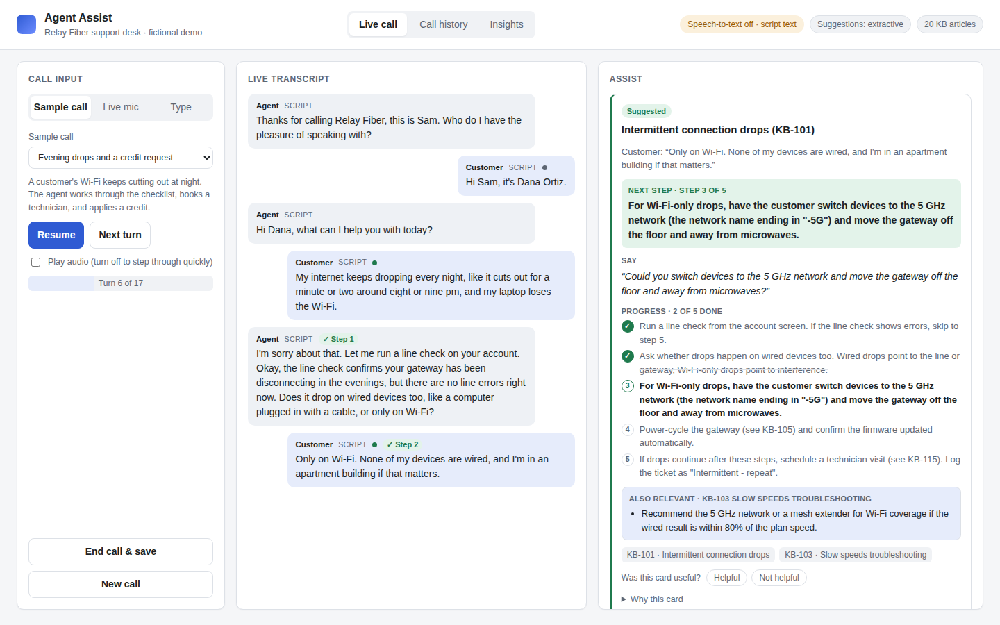
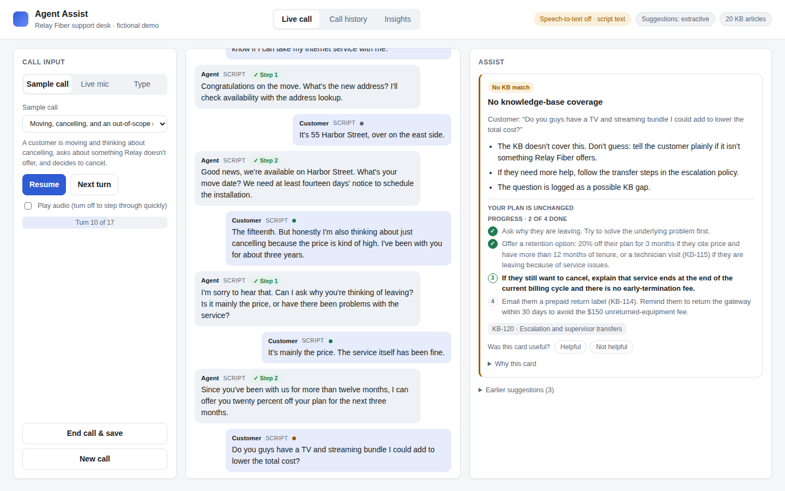
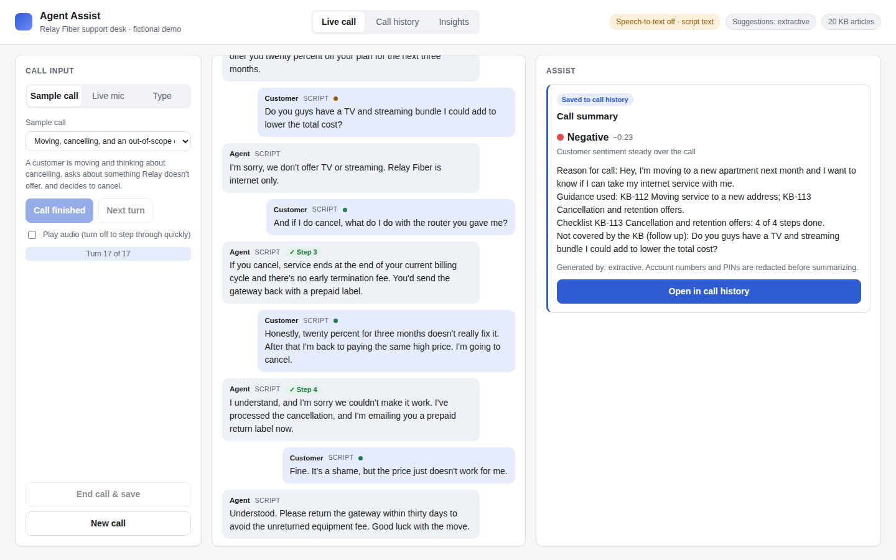
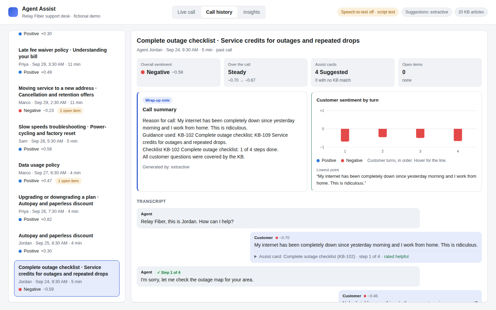
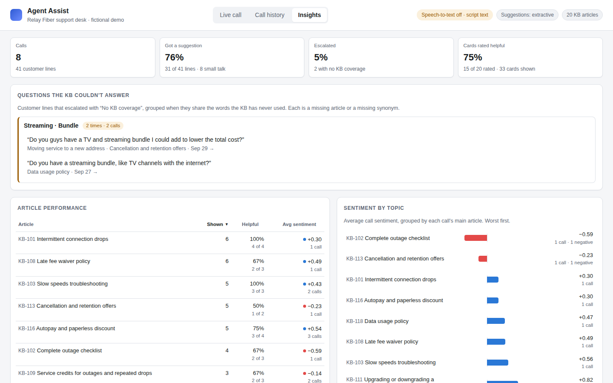
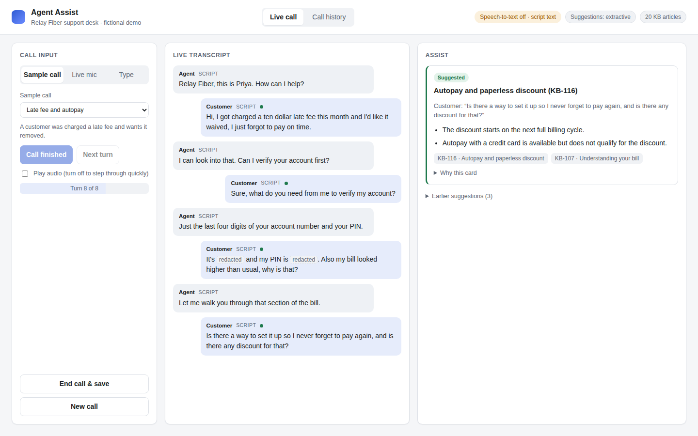

# Agent Assist

Real-time help for contact-center agents. While a support call is happening,
this app transcribes the customer, looks up the relevant knowledge-base
article, and puts a short, sourced suggestion in front of the agent. When
the knowledge base doesn't cover the question, it says so instead of
guessing. At the end of the call, it drafts the wrap-up note, rates how the
customer felt over the call, and saves everything to a call history that
supervisors can review later. An **Insights** view then closes the loop: it
lists the questions the knowledge base couldn't answer and shows which
articles agents actually found helpful.

The company, **Relay Fiber**, is a made-up internet provider. Its 20
knowledge-base articles, prices, and policies are invented for this demo.



## The problem

A support agent handles billing, outages, equipment, moves, and
cancellations, often all in one call. The answers exist in a knowledge
base, but searching it while listening to a customer is slow, so agents put
people on hold, answer from memory, or improvise policy.

An agent-assist tool fixes that only if the agent can trust it. The failure
that kills adoption isn't "the tool didn't know." It's "the tool confidently
suggested the wrong policy." So this project treats **knowing when not to
answer** as a first-class feature, and every suggestion shows where it came
from.

**Who it's for:** the human agent on the call. The customer never sees the
suggestions.

**Why a plain chatbot or KB search isn't enough:** search needs the agent to
stop and type; a general LLM will answer billing policy questions from its
training data, which knows nothing about this company's actual rules.

## How it works

```
customer audio ──▶ Whisper (local) ──▶ redact PINs/account numbers ──▶ agent loop ──▶ suggestion card
                                                                        │
                                                                        ▼
                                           end of call: wrap-up note + sentiment ──▶ call history
```

Every customer turn runs through a small [LangGraph](https://github.com/langchain-ai/langgraph) state machine:

```
track steps ──▶ triage ──small talk──────────────────────────────────────────────▶ skip (no card)
                  │
                  ▼
retrieve ──▶ grade ──good match──▶ focus ──▶ suggest ──▶ check grounding ──ok──▶ show card
  ▲            │                                              │
  │     weak match, and there's                          not grounded
  │     an earlier customer turn                               │
  │            ▼                                               ▼
  └── retry with the previous turn                  weak match again ──▶ escalate ("no KB coverage")
      as context
```

Agent turns never get a card, but they go through step tracking, so the card
moves to the next step as the agent works.

| Step | What it does | Why |
|---|---|---|
| **Triage** | Skips greetings and thank-yous | Cards for "Hi, it's Dana" are noise that trains agents to ignore the panel |
| **Retrieve** | TF-IDF search over KB sections, after mapping customer words to KB words ("router" → "gateway") and stemming ("cancelling" → "cancel") | Customers don't talk like the KB; fast, free, and explainable |
| **Grade** | Needs two signals: similarity score *and* KB coverage (how many of the customer's words the KB has ever used) | A question about a "TV bundle" can score OK against a pricing article, but the KB has never said "TV" |
| **Retry with memory** | Prepends the previous customer turn, once | "What do I do with it?" only makes sense with the last turn |
| **Focus** | Keeps one *active issue* per call: the first matched article with a checklist. A different article takes over only if it's clearly a new issue; otherwise it's a note on the same card | A credit question mid-troubleshooting shouldn't wipe the troubleshooting plan off the screen |
| **Track steps** | After every turn, agent or customer, marks a checklist step done when the turn shares 2+ of the step's distinctive words | The card should show what to do *next*, not what was already done |
| **Suggest** | Shows the next checklist step (verbatim), a line to say, the progress, and an optional policy note. Articles without a checklist get the most relevant lines, verbatim | The agent needs an action, not the three most similar sentences |
| **Check grounding** | When Claude writes the suggestion instead, every line must cite an article that was actually retrieved | Catches a model citing, or inventing, an article it wasn't given |
| **Escalate** | "No KB coverage — don't guess," and logs a KB gap | Wrong confident answers are worse than no answer |

Click **Why this card** on any suggestion to see the score, coverage,
latency, and each step the agent took, including which checklist steps were
marked done and which words matched.

### What a card shows

For a troubleshooting or process article (a numbered "Steps for the agent"
list in the KB):

- **Next step**: the next checklist item that isn't done, word for word from the KB.
- **Say**: one short line for the customer. Without an API key it's the step
  in a fixed template ("Can you tell me whether drops happen on wired devices
  too?"); with Claude, Claude writes it and must cite the article.
- **Progress**: "Step 3 of 5", with done steps ticked.
- **Policy / Also relevant**: lines from another article when the customer
  asks about something else. In the sample call, the credit question adds
  KB-109's goodwill-credit policy under the KB-101 plan instead of replacing it.

Articles without a checklist (billing policies, pricing) keep the old card:
the most relevant KB lines.



## Call history and sentiment

Clicking **End call & save** stores the call: the redacted transcript, the
assist card shown on each customer turn, the wrap-up summary, and the
customer's sentiment.


 **Call history** lists every saved call with its
overall sentiment and any open items, and each call opens into:

- **Overall sentiment**, positive, neutral, or negative, and whether the
  customer's mood improved, worsened, or held steady over the call.
- **Sentiment by turn**, one column per customer line. Hover a column to see
  the line; click it to jump there in the transcript.
- **Lowest and highest points**, the exact lines that drove the rating, so
  the score is never a black box.
- **The wrap-up note** and the **full transcript**, with each turn's
  sentiment score and the assist card the agent saw.



Sentiment uses [VADER](https://github.com/cjhutto/vaderSentiment), a
lexicon-based model that runs offline in microseconds, tuned for support
calls. Out of the box it misreads this domain: it scores "Can I get some kind
of **credit** on my bill?" as clearly *positive*, because "credit" and "kind"
are positive words in everyday English. The domain lexicon neutralizes
billing words and adds weight to outage and churn words ("dropping",
"outage", "cancel"). The call-level score weights later turns more heavily,
because most people calling support start out unhappy, and how they sound at
the end says more about whether the call helped.

On first start, the history is seeded with eight calls. They aren't
hand-written results: their transcripts run through the same assist,
summary, and sentiment pipeline as a live call. The only hand-written part
is how the demo agents rated some of the cards.

## Insights

Every card in the live view has **Helpful** / **Not helpful** buttons. The
rating is saved with that turn in the call record, and the call history
transcript shows it ("rated not helpful") and lets you change it after the
call. The **Insights** tab turns all saved calls into four answers:

- **Totals**: calls, the share of customer lines that got a suggestion or
  escalated, and the share of rated cards that agents found helpful.
- **Questions the KB couldn't answer**: every line that escalated with "No
  KB coverage", grouped when the lines share the words the KB has never
  used, most frequent first. Each example links to its call and line. In
  the seeded history, the TV and streaming bundle question shows up twice,
  from two different calls.
- **Article performance**: for each article, how many cards it supplied, the
  helpful rate, and the average sentiment of the calls that used it.
  Sortable by any column.
- **Sentiment by topic**: average call sentiment grouped by each call's main
  article, worst first, in the same blue/red as the per-call chart.



The two kinds of miss show up in different places, which is the point:

- A **safe miss** (the agent escalated) is a KB gap: a missing article, or a
  missing synonym when the KB does cover it in other words.
- A **confident wrong answer** never escalates, so it can't show up as a
  gap. It shows up as "Not helpful" votes. In the seeded history, "Do you
  offer a student discount?" gets the autopay card (KB-116) and "What plans
  do you have?" gets the data-usage policy (KB-118), and the agents voted
  both down. The ratings are how you find the dangerous kind.

Everything is computed on request from the saved calls (`GET /api/insights`),
so a call you just ended, or a rating you just changed, is included the next
time you open the tab.

## Run it

Requires Python 3.10+, Node 18+, and ffmpeg (for speech-to-text only).

### In VS Code (easiest)

1. Open the project folder in VS Code and install the recommended Python
   extension if prompted.
2. **Terminal → Run Task → Set up project.** One time: creates `.venv`,
   installs everything, and builds the UI.
3. **Press F5** (Run Agent Assist). The app opens in your browser at
   <http://localhost:8000>.

Other tasks under **Terminal → Run Task**: *Run tests*, *Run evaluation*,
*Reset call history*, and *UI dev server (hot reload)*. There's also a
**Run Agent Assist (no speech-to-text)** launch option for a quick start
without loading Whisper.

### From a terminal

```bash
# Windows (PowerShell)
powershell -ExecutionPolicy Bypass -File scripts\setup.ps1
.venv\Scripts\python.exe -m assist.server

# macOS / Linux
./scripts/setup.sh
.venv/bin/python -m assist.server
```

Then open <http://localhost:8000>. The UI lives in `web/`; running
`npm install` from the project root also works and installs it there.

### Speech-to-text on first run

Whisper loads in the background when the server starts. The first time, it
downloads the model (about 150 MB), and the header shows "Loading
Whisper…" until it's ready. The app is usable the whole time: sample-call
turns use the script text until Whisper is ready. If Whisper can't load (no
internet, no ffmpeg), the header says so and everything except the live mic
keeps working.

Three ways to feed it a call:

- **Sample call** plays one of three scripted calls turn by turn. Each turn's
  audio is transcribed by Whisper. If Whisper isn't installed, it uses the
  script's text and the header says so, so the demo still works offline.
- **Live mic**: you play the customer. Hold the button, talk, release.
- **Type**: backup mode, type what the customer says.

Optional settings (see `.env.example`):

| Variable | Effect |
|---|---|
| `ANTHROPIC_API_KEY` | Claude drafts suggestions and the wrap-up note instead of the extractive defaults. Nothing else changes. |
| `ASSIST_WHISPER_MODEL` | `tiny.en` (fastest), `base.en` (default), `small.en` (most accurate). Downloads on first use. |
| `ASSIST_DB` | Where saved calls go. Default `data/history/history.db`; delete it to re-seed. |

The sample-call audio in `data/calls/audio/` was originally generated with espeak-ng,
which sounds robotic. To regenerate it with natural voices, run the task
**Terminal > Run Task... > Regenerate sample-call audio (natural voices)**, or from a terminal:

```bash
pip install -e ".[voices]" && python scripts/make_call_audio.py --engine piper
```

This uses [Piper](https://github.com/OHF-Voice/piper1-gpl), a free, offline neural TTS,
with a different voice for the agent and the customer in each call. The voices
(about 60 MB each) download once into `.cache/piper-voices/`. Add `--call call-01`
to regenerate one call. Without Piper installed, the script falls back to espeak-ng.
You can also record the lines yourself and save them over the same file paths.

## Evaluation

```bash
python -m pytest              # 61 tests, no API key or model download needed
python scripts/run_eval.py    # writes data/eval/results.md
```

The eval scores the whole loop, not just retrieval: in-scope lines should
get a card with the right article, out-of-scope lines should escalate, and
small talk should be skipped. It uses a **held-out set of 26 customer
lines** written before the thresholds and synonym list were set.

| Held-out set | Result |
|---|---|
| Right article in retrieval top 3 | 17/20 (85%) |
| In-scope line gets the right card | 14/20 (70%) |
| Out-of-scope line escalates | 3/4 (75%) |
| Small talk skipped | 2/2 (100%) |
| **Overall** | **19/26 (73%)** |

The three demo calls pass 24/24 customer lines, but I set the thresholds
(and wrote the step-tracking rules) by looking at those calls, so that
number shows the demo works as designed. It doesn't show how well the
approach generalizes. The held-out lines are scored one at a time, with no
call state, so they don't exercise the active issue or step tracking at all. The held-out score has moved as the
code changed (69% → 65% → 73%); `docs/decisions.md` explains each change
and why none of them were tuned on the held-out lines.

The misses fall into two groups, and the difference matters:

- **Safe misses (4):** the right answer was in the KB, but the customer's
  wording ("relocating", "send back", "come out to my house") didn't
  match, so the agent escalated. The agent loses a few seconds, not trust.
- **Confident wrong answers (3):** "Do you offer a student discount?"
  surfaced the *autopay* discount. This is the dangerous kind, and it's
  where I'd focus next (see below).

The full per-line table is in [`data/eval/results.md`](data/eval/results.md).

## Design decisions

The short version is below. [`docs/decisions.md`](docs/decisions.md) has the reasoning and tradeoffs.

- **Lexical retrieval, not embeddings.** A 20-article KB with product
  vocabulary suits TF-IDF: no model, no API key, millisecond lookups, and
  you can see exactly why something matched. The cost is paraphrases, which
  is exactly where the safe misses come from.
- **Two grading signals.** In an early version, the TV-bundle question
  scored *higher* (0.127) than a real cancellation question (0.120). It's
  still true today: in the seeded history, "Do you have a streaming bundle,
  like TV channels with the internet?" scores 0.29, level with "I'd like to
  cancel my account" (0.29), and only coverage (25%) stops it. (The bundle
  question in sample call 3 now fails both checks: 0.11 and 17%.)
- **Extractive by default, Claude optional.** Runs anywhere with no key, and
  grounding is trivially checkable. Claude writes better sentences, so its
  output gets a stricter check (must cite a retrieved article).
- **Cards follow the article's checklist, with memory across the call.**
  Picking the sentences most similar to the last line surfaced "Likely
  causes" instead of "what to do", and lost the plan whenever the customer
  asked a side question. Step tracking is plain word overlap with a fixed bar,
  so every tick on the checklist can be explained. It also can't tell
  "I ran a line check" from "I won't run a line check".
- **Local Whisper.** Call audio never leaves the machine.
- **Redact before anything is stored.** Account numbers and PINs spoken
  during verification never reach the transcript, the summary, or an LLM.



## What I'd build next

1. **Fix the confident-wrong-answer case first.** Add a check that the
   customer's key noun (e.g. "student") actually appears in the matched
   article, and try hybrid retrieval (TF-IDF plus embeddings) for
   paraphrases.
2. **Act on the Insights view.** The gap list and the ratings now show
   where the KB falls short; the next step is making that one click: turn a
   gap group into a draft synonym entry or article stub for review. Gap
   grouping should also move from shared words to embeddings (see
   `docs/decisions.md`).
3. **Expose it over MCP.** Right now the only consumer is a human looking
   at the UI. Wrapping the agent as an [MCP](https://modelcontextprotocol.io)
   server (`suggest_for_utterance`, `search_kb`, `summarize_call`,
   `report_kb_gap`) would let other AI systems use the same grounded
   guidance: a CRM copilot, a self-service chatbot, or Claude itself. The
   graph wouldn't change; MCP is a new front door to it.
4. **Streaming transcription.** Transcribing per turn adds a pause after
   the customer stops talking. Streaming partial transcripts would let
   suggestions start forming mid-sentence.
5. **Speaker separation for live calls.** Live mode currently assumes the mic
   is the customer. A real deployment gets separate agent and customer
   audio channels from the phone system.
6. **Better sentiment, measured.** The lexicon approach is fast and
   explainable but blind to sarcasm ("great, another outage") and has no
   labeled eval set yet. Next steps: label a few dozen calls, measure the
   lexicon against them, and compare an LLM rating with a short written
   reason. Show sentiment live to the agent too, not just after the call.
7. **Query across calls at scale.** Insights reads every saved call and
   computes in Python, which is fine for hundreds of calls. Splitting turns
   into their own table would let SQL answer the same questions, plus new
   ones, over months of history.

## Project layout

```
src/assist/
  kb.py          load articles, split into sections
  text.py        customer-to-KB vocabulary, stemming, filler words
  retriever.py   TF-IDF search + coverage signal
  agent.py       the LangGraph loop (track, triage, retrieve, grade, retry, focus, suggest, escalate)
  steps.py       KB checklists, the call's active issue, step tracking, "Say" templates
  suggest.py     extractive and Claude suggesters, card shapes, grounding check
  summary.py     wrap-up note
  sentiment.py   per-turn and call-level sentiment (VADER + support-call lexicon)
  history.py     saved calls (SQLite), card ratings, seeding demo history
  insights.py    KB gaps, article performance, sentiment by topic, totals
  redact.py      PIN / account-number masking
  stt.py         local Whisper transcription
  server.py      FastAPI: API + serves the built UI
web/src/         React UI (live call, call history, insights, sentiment chart)
data/kb/         the fictional Relay Fiber knowledge base
data/calls/      three scripted sample calls (17 turns each) + generated audio
data/history/    transcripts (and card ratings) for the seeded past calls
data/eval/       held-out eval lines + generated results
tests/           61 tests
docs/            design decisions, screenshots
```

## License

MIT. See `LICENSE`. All company names, policies, prices, and call scripts are fictional.
